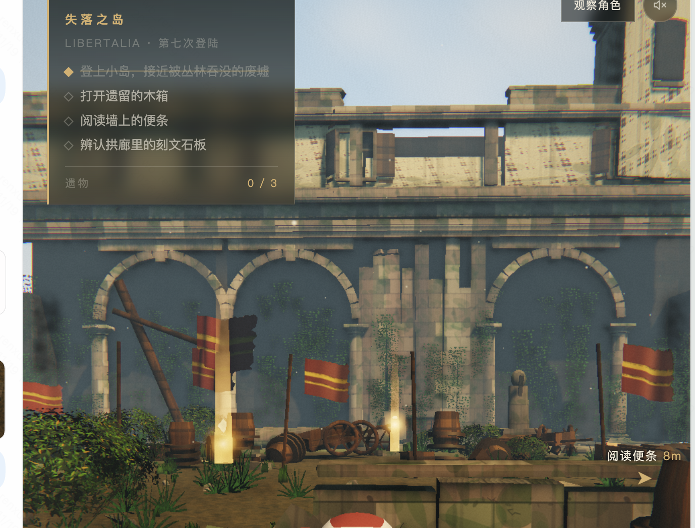
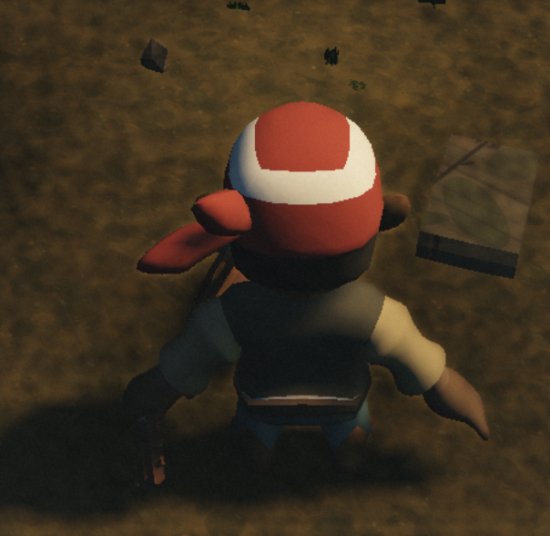

# 失落之岛 · Libertalia

用 Three.js 制作的第三人称海岛探索游戏。穿过废墟，打开木箱、阅读便条、辨认石板，收集三件遗物。

## 开发过程实机截图

以下两张记录了开发时的拱廊和 Henry 角色，建筑材质在截图后又有更新。





## 打开游戏

在本文件夹运行 `python3 -m http.server 8123`，然后打开 `http://localhost:8123/index.html`。角色模型是单独文件，因此需要通过本地网页服务打开，不能直接双击 index.html。

## 操作

- WASD 移动、Shift 疾行、空格跳跃、E 交互。
- 点击右上角「观察角色」或按 V，拖动画面可以绕角色查看正面、侧面和背面；滚轮调整远近。再按 V 返回探索。
- 触屏设备可点右上角按钮进入观察模式，并用手指拖动画面。

## 后续修改
     
| 要修改的内容 | 文件 |
| --- | --- |
| 拱廊、瞭望塔、宝箱的形状与位置 | [ruins.js](src/ruins.js) |
| 石材颜色与表面凹凸 | [石灰岩贴图目录](assets/stone/) |
| 角色模型、动画和环绕镜头 | [角色资源](assets/characters/) · [player.js](src/player.js) |
| 任务、收集与开箱动画 | [main.js](src/main.js) |
| 菜单、按钮、页面样式 | [界面模板](src/index.template.html) |

修改源码后，在项目根目录运行以下命令，再刷新游戏。提交时把源码和重新生成的 `index.html` 一起提交。

```sh
npm ci
node build.mjs
```

替换同名角色或贴图文件后可直接刷新查看。截图保存在 [docs/screenshots](docs/screenshots/)，替换同名图片即可更新本页。

## 资源授权

角色来自 Quaternius Pirate Kit，CC0 1.0：<https://quaternius.com/packs/piratekit.html>。
模型加载组件来自 Three.js r180，MIT：<https://github.com/mrdoob/three.js/blob/r180/LICENSE>。

这个角色为风格化海盗，与写实参考游戏的角色风格不同。
